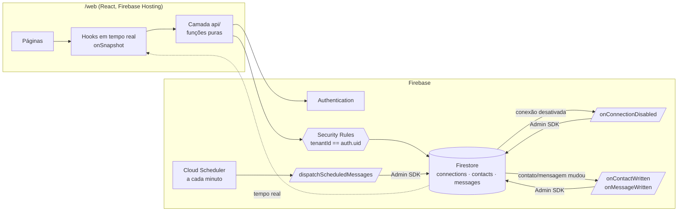
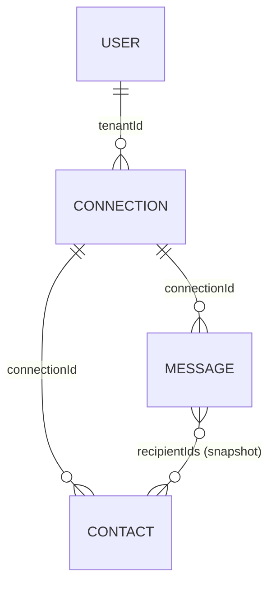

# Broadcast

[](https://github.com/renovatt/broadcast-web/actions/workflows/ci.yml)

Aplicação SaaS **multi-tenant** de envio de mensagens em massa (envio simulado), feita com
**React + TypeScript + Firebase** (Authentication, Firestore, Cloud Functions e Hosting).

> 🔗 **App publicado:** [broadcast-web-db939.web.app](https://broadcast-web-db939.web.app)
>
> 👤 **Conta de demonstração** (já com conexões, contatos e mensagens): `demo@example.com` /
> `demo1234` — ou crie sua própria conta; cada cliente só enxerga os próprios dados.
>
> ℹ️ A versão publicada está no plano gratuito do Firebase (Spark), que não permite Cloud Functions.
> Elas rodam 100% no emulador e são cobertas por testes de integração no CI — veja
> [App publicado no plano gratuito](#app-publicado-no-plano-gratuito-spark).

Cada usuário cadastrado é um **cliente**. O cliente gerencia suas **conexões**; cada conexão tem
seus **contatos** e suas **mensagens**. Mensagens podem ser enviadas na hora ou **agendadas** — no
horário, uma Cloud Function as marca como enviadas, **mesmo com o app fechado**.

## Demonstração

<video src="web/public/assets/broadcast-demo.mp4" controls muted width="100%"></video>

▶️ [Assistir à demonstração](web/public/assets/broadcast-demo.mp4)

---

## Sumário

- [Demonstração](#demonstração)
- [Funcionalidades](#funcionalidades)
- [Stack](#stack)
- [Arquitetura](#arquitetura)
- [Modelagem de dados](#modelagem-de-dados)
- [Isolamento entre clientes](#isolamento-entre-clientes)
- [Soft delete](#soft-delete)
- [Cloud Functions](#cloud-functions)
- [Organização do código](#organização-do-código)
- [Qualidade e testes](#qualidade-e-testes)
- [Rodando localmente](#rodando-localmente)
- [Deploy](#deploy)
- [Decisões técnicas](#decisões-técnicas)
- [Scripts](#scripts)

---

## Funcionalidades

| Requisito                       | Como foi atendido                                                                                           |
| ------------------------------- | ----------------------------------------------------------------------------------------------------------- |
| Login e cadastro                | Firebase Auth com **e-mail/senha** e **Google**; rotas protegidas; sessão persistente                       |
| Cada usuário é um cliente       | O `uid` do usuário é o `tenantId` de todos os seus dados                                                    |
| CRUD de conexões                | Lista em cards, criar/editar/excluir, resumo em tempo real (contatos, enviadas, agendadas)                  |
| CRUD de contatos por conexão    | Tabela com busca, máscara de telefone, validação e bloqueio de telefone duplicado na conexão                |
| Broadcast                       | Selecionar contatos, escrever, **enviar agora** ou **agendar** (data/hora futura)                           |
| Visualizar e filtrar mensagens  | Histórico com filtros **Todas / Enviadas / Agendadas** e contadores                                         |
| Editar e excluir mensagens      | Agendadas podem ser editadas (texto, destinatários, data ou "enviar agora"); qualquer uma pode ser excluída |
| Agendada → Enviada no backend   | Cloud Function agendada a cada minuto, independente do navegador                                            |
| Tempo real                      | Todas as listas usam `onSnapshot`; mudanças feitas pelas functions aparecem sem recarregar                  |
| SaaS multi-tenant / isolamento  | Security Rules + `tenantId` em todos os documentos + testes de acesso cruzado                               |
| Sem subcoleções                 | Três coleções na raiz, relacionadas por ID                                                                  |
| MUI + Tailwind, Vite, funcional | MUI para componentes, Tailwind para layout; Vite; sem classes (regra de lint)                               |

## Stack

- **Frontend (`/web`)**: React 19, TypeScript, Vite, Material UI (+ MUI X Date Pickers), Tailwind CSS 4,
  React Router, React Hook Form + Zod, Zustand, Day.js, `@react-input/mask`.
- **Backend (`/functions`)**: Cloud Functions v2 (Node 24, região `southamerica-east1`), Firebase Admin SDK.
- **Firebase**: Authentication, Firestore (Security Rules + índices versionados), Cloud Scheduler, Hosting.
- **Qualidade**: Vitest, Testing Library, `@firebase/rules-unit-testing`, ESLint, Prettier, Husky + lint-staged.

## Arquitetura



O navegador só lê e escreve o que as Security Rules permitem. Tudo que precisa acontecer **sem o
usuário** (envio agendado, cascata da exclusão, contadores) roda nas Cloud Functions com o Admin SDK.

## Modelagem de dados

Três coleções **na raiz** — sem subcoleções — relacionadas por ID. **Todo documento carrega
`tenantId`** (o `uid` do cliente dono) e os campos de ciclo de vida
`enabled`, `deletedAt`, `createdAt`, `updatedAt`.



| Coleção       | Campos                                                                                                                                                     |
| ------------- | ---------------------------------------------------------------------------------------------------------------------------------------------------------- |
| `connections` | `tenantId`, `name`, `stats { contacts, sent, scheduled }` _(mantido pela Cloud Function)_                                                                  |
| `contacts`    | `tenantId`, `connectionId`, `name`, `phone` (E.164, ex.: `+5511999998888`)                                                                                 |
| `messages`    | `tenantId`, `connectionId`, `body`, `recipientIds`, `recipients` (snapshot `{id, name, phone}`), `status` (`scheduled` \| `sent`), `scheduledAt`, `sentAt` |

Escolhas:

- **`tenantId` em todas as coleções** (e não só na conexão): cada documento se protege sozinho nas
  rules e toda consulta filtra direto por dono, sem precisar ler a conexão.
- **Destinatários como snapshot**: a mensagem enviada é um registro histórico; editar ou excluir um
  contato depois não altera para quem ela foi.
- **Resumo desnormalizado** (`connections.stats`): o card mostra contagens em tempo real com uma única
  leitura por conexão, em vez de assinar todos os contatos e mensagens só para contar.
- **Timestamps sempre do servidor** (`serverTimestamp()`), validados nas rules.
- Índices compostos em [`firestore.indexes.json`](./firestore.indexes.json).

## Isolamento entre clientes

Três camadas — a primeira é a que **garante**; as outras dão consistência:

1. **Security Rules** ([`firestore.rules`](./firestore.rules)):
   - leitura e escrita só quando `tenantId == request.auth.uid`;
   - na criação, o `tenantId` tem que ser o do próprio usuário, e contatos/mensagens só podem apontar
     para uma conexão **ativa do mesmo cliente** (`get()` na conexão);
   - `tenantId` e `connectionId` são **imutáveis**; campos permitidos (`hasOnly`) e tamanhos validados;
   - mensagens: enviar agora exige `sentAt` do servidor; agendar exige data futura (até 1 ano);
     enviada não pode ser editada;
   - `stats` e a transição agendada → enviada só podem ser escritas pelo backend.
2. **Consultas sempre filtradas por `tenantId`** — regras não funcionam como filtro: uma consulta sem
   esse `where` é negada inteira, o que força o código a estar correto.
3. **Interface**: abrir pela URL uma conexão de outro cliente mostra "Conexão não encontrada" (a mesma
   resposta de uma inexistente, sem vazar informação).

Os cenários de acesso cruzado (ler, listar, editar, excluir, mover dados de outro cliente) são
cobertos por **44 testes automatizados das rules** — `npm run test:rules`.

## Soft delete

Nada é apagado de verdade. "Excluir" desativa o documento:

- todo documento nasce com `enabled: true` e `deletedAt: null`;
- excluir = `enabled: false` + `deletedAt` do servidor; **as rules proíbem `delete`** e qualquer outra
  alteração junto;
- documentos desativados não podem ser editados nem reativados pelo cliente;
- toda consulta usa `where('enabled', '==', true)`;
- excluir uma conexão desativa seus contatos e mensagens (Cloud Function de cascata) — e mensagens
  agendadas de uma conexão excluída nunca são enviadas;
- o dono ainda pode ler os próprios desativados (base para uma futura lixeira).

## Cloud Functions

| Function                                | Gatilho                                        | O que faz                                                                                |
| --------------------------------------- | ---------------------------------------------- | ---------------------------------------------------------------------------------------- |
| `dispatchScheduledMessages`             | Cloud Scheduler, a cada minuto                 | Marca como `sent` as mensagens agendadas e ativas cujo horário chegou                    |
| `onConnectionDisabled`                  | Update em `connections/{id}` (ativa → inativa) | Cascata do soft delete: desativa contatos e mensagens da conexão com o mesmo `deletedAt` |
| `onContactWritten` / `onMessageWritten` | Escrita em `contacts/{id}` / `messages/{id}`   | Recalcula o resumo `connections/{id}.stats`                                              |

- **Envio agendado**: idempotente (só processa `scheduled`), seguro contra concorrência (cada escrita
  usa a precondição `lastUpdateTime` — se o usuário editou ou excluiu a mensagem no mesmo instante,
  ela é ignorada e reavaliada no minuto seguinte), paginado em lotes de 500 com `BulkWriter`.
  Precisão de até ~1 minuto.
- **Resumo**: **recalculado** com `count()` dentro de uma transação (não somado/subtraído), então
  eventos repetidos ou fora de ordem não deixam o número errado. Só roda quando algo que afeta a
  contagem muda.
- **Padrão**: o gatilho só chama uma função pura que recebe o `db` — e essa função é testada contra o
  emulador do Firestore.

## Organização do código

```
/web          frontend
/functions    Cloud Functions
/tests        testes das Security Rules
/scripts      utilitários (JDK portátil, simulador do Cloud Scheduler)
firebase.json · firestore.rules · firestore.indexes.json
```

`web/src`:

```
app/            bootstrap: providers, tema, rotas e guards
components/     componentes globais reutilizáveis (+ rhf/: campos ligados ao react-hook-form)
shared/         funções, hooks e stores compartilhados (sem componentes)
lib/            inicialização do Firebase
features/<nome>/
  _components/  componentes da feature
  api/          acesso ao Firestore (funções puras)
  hooks/  schemas/  stores/  types/  utils/
  pages/        telas ligadas às rotas
  __tests__/    testes da feature
```

Convenções (verificadas pelo ESLint):

- **paradigma funcional**: `class` é proibido; dados como `type`, comportamento como funções;
- camadas: `api/` (Firestore) → `hooks/` (estado React, tempo real) → componentes (só renderizam);
- arquivos e pastas em `kebab-case`; nada solto na raiz de uma feature; `shared/` sem componentes;
- estado global com **Zustand** (sessão e notificações), sem React Context;
- imports internos pelo alias `@/` → `web/src`.

## Qualidade e testes

| Suíte                     | Quantidade | Comando                  | O que cobre                                                          |
| ------------------------- | ---------- | ------------------------ | -------------------------------------------------------------------- |
| Unidade (`/web`)          | 300        | `npm test`               | Componentes, páginas, hooks, schemas, utilitários (Firebase mockado) |
| Security Rules (`/tests`) | 44         | `npm run test:rules`     | Isolamento entre clientes, validações, soft delete                   |
| Integração (`/functions`) | 33         | `npm run test:functions` | Lógica das functions com o Admin SDK real no emulador                |

- Os testes de rules e de functions rodam contra os **emuladores** e têm trava: nunca tocam no projeto real.
- **CI (GitHub Actions)** — [`.github/workflows/ci.yml`](./.github/workflows/ci.yml), a cada push e
  pull request, em dois jobs paralelos: (1) formatação, lint, tipos, testes de unidade e build;
  (2) testes das Security Rules e das Cloud Functions no emulador.
- **Husky** (local): o _pre-commit_ roda ESLint + Prettier nos arquivos alterados, typecheck e testes
  de unidade; o _pre-push_ roda o build.
- Os fluxos completos (incluindo envio agendado com o app fechado, cascata e isolamento entre dois
  usuários) também foram validados no navegador contra os emuladores.

## Rodando localmente

Pré-requisitos: **Node.js 24**. O Java 21 exigido pelos emuladores **não precisa ser instalado**:
`npm run setup:jdk` baixa um JDK portátil para `.tools/` (ignorado pelo git).

```bash
npm run install:all   # instala raiz, web e functions
npm run setup:jdk     # JDK portátil para os emuladores (uma vez)
```

### Tudo local, com os emuladores (não precisa de projeto Firebase)

Em três terminais:

```bash
npm run emulators      # Auth, Firestore, Functions e Pub/Sub (UI em http://localhost:4000)
npm run dev:emulator   # app em http://localhost:5173, ligado só aos emuladores (web/.env.emulator)
npm run scheduler      # simula o Cloud Scheduler: executa o envio agendado a cada minuto
```

O emulador não executa funções agendadas sozinho — `npm run scheduler` faz esse papel. A cascata e o
resumo rodam sozinhos (triggers do Firestore). Os dados ficam só na memória dos emuladores.

### Contra um projeto Firebase real

```bash
cp web/.env.example web/.env.local   # preencha com a config do app Web do Firebase
npm run dev
```

## Deploy

Com o projeto configurado em `.firebaserc`:

```bash
npx firebase login
npm run deploy             # build do /web + rules + índices + hosting (funciona no plano Spark)
npm run deploy:functions   # Cloud Functions + Cloud Scheduler (exige o plano Blaze)
```

Os índices compostos levam alguns minutos para ficar ativos após o primeiro deploy.

### App publicado no plano gratuito (Spark)

A versão publicada roda no plano **Spark**, que não permite Cloud Functions. Todo o resto
(autenticação, CRUDs, envio imediato, tempo real, rules e isolamento) funciona igual. Sem as
functions:

- mensagens **agendadas permanecem como Agendadas** — a página de broadcast avisa isso;
- o **resumo** dos cards de conexão não é calculado e fica oculto;
- excluir uma conexão não desativa seus contatos e mensagens em cascata (eles ficam inacessíveis
  pela interface, já que a conexão some).

O build de produção usa `VITE_FUNCTIONS_ENABLED=false` em `web/.env` para ativar esse modo.

**As Cloud Functions estão completas e rodam 100% no Firebase Emulator Suite** — agendamento
(`dispatchScheduledMessages`), cascata (`onConnectionDisabled`) e resumo das conexões
(`onContactWritten` / `onMessageWritten`). A limitação é só de plano de cobrança, não de código:

- **Na prática**: com os emuladores ([Rodando localmente](#rodando-localmente)), mensagens
  agendadas viram Enviadas no horário, mesmo com o app fechado, e o resumo e a cascata funcionam.
- **Testes de integração**: 33 testes (`npm run test:functions`) executam a lógica das functions
  com o Admin SDK real contra o emulador do Firestore — envio no horário, idempotência, paginação,
  cascata e contagem do resumo.
- **CI**: esses testes rodam a cada push no GitHub Actions (job _Security Rules e Cloud Functions_),
  junto com os 44 testes das Security Rules.

## Decisões técnicas

- **Function agendada a cada minuto em vez de uma tarefa por mensagem (Cloud Tasks)**: simples de editar
  e cancelar (basta mudar o documento), idempotente e sem estado extra; o custo é uma precisão de até
  ~1 minuto, adequada ao caso.
- **Filtro Enviadas/Agendadas no cliente**: uma única inscrição em tempo real por conexão traz as
  mensagens ativas; filtro e contadores saem dela, sem novas consultas ao trocar de aba.
- **Soft delete garantido pelas rules**, não só pela interface.
- **Cascata no backend**: sem subcoleções não existe exclusão "em árvore"; a function trata isso.
- **Telefone em E.164** no banco (`+5511999998888`), com máscara brasileira na interface e validação
  igual no cliente e nas rules.
- **Login com Google por popup**: evita problemas do redirect com cookies de terceiros bloqueados.
- **Limitação conhecida**: as rules não conseguem validar cada item de `recipientIds` (não há laço);
  os IDs vêm de contatos que o próprio cliente só consegue ler se forem dele.

## Scripts

| Script                     | Descrição                                            |
| -------------------------- | ---------------------------------------------------- |
| `npm run dev`              | App contra o projeto Firebase real                   |
| `npm run dev:emulator`     | App contra os emuladores                             |
| `npm run emulators`        | Compila as functions e sobe os emuladores            |
| `npm run scheduler`        | Simula o Cloud Scheduler local (envio a cada minuto) |
| `npm test`                 | Testes de unidade do `/web`                          |
| `npm run test:rules`       | Testes das Security Rules                            |
| `npm run test:functions`   | Testes de integração das Cloud Functions             |
| `npm run build`            | Build de `/web` e `/functions`                       |
| `npm run deploy`           | Publica hosting, rules e índices (plano Spark)       |
| `npm run deploy:functions` | Publica as Cloud Functions (plano Blaze)             |
| `npm run lint`             | ESLint em `/web` e `/functions`                      |
| `npm run typecheck`        | TypeScript em `/tests`, `/web` e `/functions`        |
| `npm run format`           | Prettier                                             |
| `npm run setup:jdk`        | Baixa o JDK 21 portátil usado pelos emuladores       |
